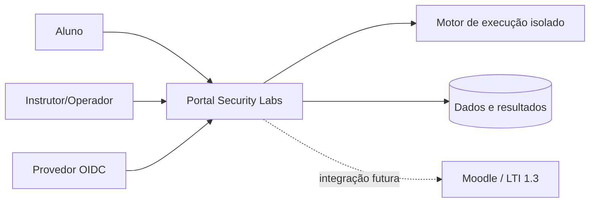
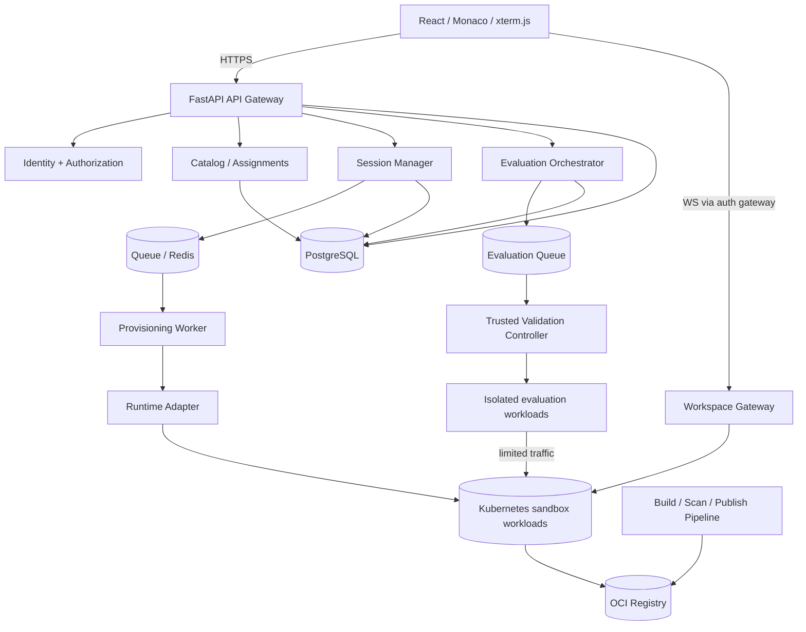

# 06. Arquitetura do Sistema

| Campo | Valor |
|---|---|
| Versão | 0.2.0 |
| Estado | Proposta para PoC e revisão; não aprovada |
| Referências | `02_PRD.md`, `07_THREAT_MODEL.md`, ADR-001/002/003 |

## 1. Decisão diretriz

Adotar **monólito modular de controle** (FastAPI) com execução assíncrona e workers, e um **plano de execução separado e não confiável**. Evitar microsserviços distribuídos prematuros. API e estruturas acadêmicas devem ser independentes do runtime e dos laboratórios específicos. Integração Moodle/LTI não é P0, mas as APIs serão versionadas.

## 2. Contexto (C4 nível 1)



## 3. Contêineres lógicos (C4 nível 2)



**Fronteiras:** cliente sem confiança; controle confiável protegido; gateway de acesso por usuário/sessão; ambientes de laboratório não confiáveis; executor de avaliação em sandbox igualmente restrito quando executar código do aluno. Runner de controle e segredos nunca compartilham contêiner editável.

## 4. Módulos de backend e dependências

```text
backend/
  app/
    identity/             # OIDC, RBAC, autorização por objeto
    catalog/              # Lab, LabVersion, Assignment
    sessions/             # agregados, state machine, quotas, TTL
    runtime/              # port/adapters: provision, status, reset, stop
    gateway/              # grants e routing autenticado
    evaluations/          # attempts, snapshot refs, scheduling
    grading/              # criteria, results, completion
    cohorts/              # turmas e instructor scope
    reporting/            # agregados e CSV
    audit/                # eventos minimizados
    shared/               # IDs, clock, correlation, errors
  workers/
    provisioner/
    evaluator/
    reconciler/
frontend/
infra/
laboratories/
```

Regras: somente `runtime` conhece APIs concretas de Kubernetes; `sessions` chama `RuntimePort`. O agregado `EvaluationRun` refere `snapshot_digest` e `suite_digest`. Transições são persistidas antes de efeitos externos por outbox/idempotência. **Uma turma não equivale a tenant isolado** no MVP; autorização por escopo de turma é obrigatória.

## 5. Fluxos críticos

### Iniciar

1. `POST /api/v1/sessions` valida OIDC, assignment, quota e idempotency key.
2. Transação cria Session `REQUESTED`, um `ProvisioningJob`/outbox e a versão de lab imutável.
3. Worker busca job com lock/lease, chama adapter com `session_id` como chave estável.
4. Adapter aplica política runtime, image digest, quotas e labels no workload.
5. Health checks atingem `READY`, API libera grant curto para gateway; UI acessa app/editor/terminal.
6. Reconciliador compara estado desejado no banco com instâncias reais e elimina órfãos.

### Avaliar

1. `POST /sessions/{id}/attempts` valida estado, ownership, limite e idempotência.
2. Captura snapshot consistente (freeze ou cópia atômica versionada), calcula digest e persiste `Attempt`.
3. Cria `EvaluationRun` e agenda runner. Runner busca suite por digest de origem confiável.
4. Testes rodam em ambiente de avaliação segregado; resultado autenticado é persistido com unicidade e audit trail.
5. Aplicação calcula nota e completion por critérios versionados; aluno consulta polling inicialmente.

### Terminar

1. Marcar intenção `TERMINATING`, revogar acesso e tokens de gateway.
2. Orquestrador remove instância, rede/volume temporário e conexões.
3. Confirmar ausência de recursos antes de `TERMINATED`; registrar evidência. Reconciliação corrige falhas.

## 6. Principais contratos internos

| Port | Assinatura conceitual | Semântica |
|---|---|---|
| `RuntimePort.provision` | `(session_id, lab_version, policy) -> runtime_ref` | idempotente |
| `RuntimePort.status` | `(runtime_ref) -> status, health` | somente observação |
| `RuntimePort.terminate` | `(runtime_ref) -> acknowledgement` | idempotente; confirmação assíncrona |
| `WorkspaceSnapshotPort.capture` | `(session_id, revision) -> digest/ref` | snapshot imutável e verificável |
| `EvaluationPort.submit` | `(attempt_id, snapshot_ref, suite_digest) -> run_id` | idempotente |
| `ResultPort.record` | `(run_id, signed_result) -> result` | valida emissor e unicidade |

## 7. Persistência e eventos

PostgreSQL para dados duráveis; Redis somente fila/cache/locks de curta duração, **não** fonte de verdade acadêmica. Object storage para snapshots/evidências com retenção e controle por identidade. OCI registry para imagens por digest. Eventos sugeridos: `SessionRequested`, `SessionReady`, `SessionExpired`, `SessionTerminated`, `AttemptSubmitted`, `EvaluationCompleted`, `LabVersionPublished` e `SecurityPolicyDenied`; correlation IDs atravessam API, worker, runtime e runner.

## 8. Deploy, falhas e observabilidade

- Ambientes dev/staging/prod separados; cluster ou pool de nós para labs sem acesso aos serviços de controle. Não expor Kubernetes API ao lab.
- API stateless com migrações controladas. `ProvisioningWorker` e reconciliador com leases, retry bounded exponential backoff e dead-letter operacional.
- Métricas NFR-003/004/005/007/013: latência REQUESTED→READY, `active_sandboxes`, falhas por etapa, avaliações, custos aproximados, cleanup_age; labels sem PII.
- Dashboard operacional e alertas para runtimes órfãos, filas travadas, egress negado, consumo anômalo, taxa de falha e saturação.
- APIs nunca retornam destinos arbitrários de workloads; gateway resolve `session_id -> runtime_ref` autorizado.

## 9. Decisões pendentes e provas

| Item | Hipótese inicial | Como decidir |
|---|---|---|
| Runtime isolado | Kubernetes + gVisor/Kata/microVM conforme perfil | PoC segurança, P95 startup, custo, compatibilidade |
| Gateway | proxy HTTP/WS com grants expiráveis | PoC terminal + preview + revogação |
| Congelamento do workspace | snapshot imutável de artefatos selecionados | PoC concorrência e avaliação idempotente |
| Storage | arquivos em volume efêmero e snapshot em objeto | PoC reset e limites de disco |
| OIDC provider | configurável, sem vendor lock-in | validar integração em staging |

**Condições de aceite de arquitetura:** E2E-01/02/05/06/08/09, revisão STRIDE e ADRs assinados. Diagramas são alvos de construção, não documentação de serviços existentes.

## Adendo v0.3: decisão de implantação e domínio pedagógico

Implantação inicial on-premises por decisão de produto. Separar zonas administrativas e de sandbox em infraestrutura/rede próprias; Kubernetes on-prem e sandbox reforçado são propostas condicionadas à PoC. Modelo pedagógico: Lab -> Release -> Variant -> Step -> Hint; validação por StepAttempt e liberação transacional de StepProgress. Ver ADR-004, documentos 11, 12, 13 e 21.
