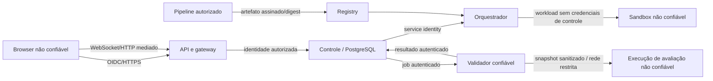

# 07. Modelo de Ameaças (STRIDE)

| Campo | Valor |
|---|---|
| Versão | 0.2.0 |
| Status | Proposta técnica para revisão de segurança; **não aprovada** |
| Base | `02_PRD.md` FR-001–054, NFR-001–015; `ADR/ADR-002-isolation.md` |

## 1. Escopo, hipóteses e ativos

**Escopo:** portal/API, gateway HTTP/WebSocket, plano de controle, sistema de identidade, registry e pipeline de publicação, orchestrator, runtime efêmero, workspace, mecanismo de snapshot, runner de avaliação, resultados, observabilidade e backups. Cada usuário de laboratório é considerado potencialmente adversarial, inclusive quando está autenticado. Os quatro labs são intencionalmente vulneráveis; isso **não autoriza** atingir terceiros ou a plataforma de gestão.

**Ativos prioritários:** (A1) credenciais OIDC, tokens de gateway e serviços; (A2) resultados/notas e tentativas; (A3) integridade dos validadores e suas soluções ocultas; (A4) controle de orquestração e host; (A5) dados e workspace de outros alunos; (A6) imagens/artefatos publicados; (A7) disponibilidade, quotas e orçamento; (A8) logs e informações pessoais. Dados de exercícios devem ser sintéticos.

**Atores:** aluno legítimo, aluno malicioso, instrutor com acesso limitado, autor de conteúdo, operador, invasor externo, dependência comprometida e processo do sandbox comprometido. Autor/operador não são automaticamente confiáveis para todas as operações; aplicar segregação e auditoria.

## 2. Fronteiras de confiança

**T1** navegador → API: sessões, CSRF, IDOR, tokens e WebSocket. **T2** API → orquestrador: credenciais privilegiadas. **T3** gateway → sandbox: roteamento e escapes. **T4** sandbox → redes/host: egress, metadata, escalada. **T5** snapshot do aluno → runner: código não confiável. **T6** runner → notas: integridade. **T7** CI/CD → registry: cadeia de suprimentos. **T8** logs/objetos → consumidores: privacidade e vazamento.

## 3. Matriz STRIDE e controles mínimos

| ID | Fronteira | STRIDE | Cenário de abuso | Mitigação P0 | Teste/evidência |
|---|---|---|---|---|---|
| TM-01 | T1 | S/E | Token ou session_id de outro aluno | OIDC, token curto, ownership em REST, WebSocket e gateway | SEC-01: aluno A recebe 403/404 ao acessar B |
| TM-02 | T1 | T/R | Falsificar nota ou negar envio | somente avaliação do serviço; eventos imutáveis/auditáveis | SEC-02: rejeição de resultado injetado pelo cliente |
| TM-03 | T1/T3 | I | URL previsível/roteamento arbitrário expõe outro lab | rotas server-side ligadas à sessão e destino registrado; anti-SSRF | SEC-03: rejeitar host/header/URL manipulados |
| TM-04 | T2 | E | Sandbox consegue alcançar API K8s/socket do host | identidade segregada, sem host mounts, sem service account no lab | SEC-04: negar acesso ao plano de controle |
| TM-05 | T4 | E/T | Escape via kernel, syscall ou montagem | runtime endurecido, rootless/non-root, seccomp, capabilities mínimas, sem privileged | SEC-05: suíte de isolamento e parecer da PoC |
| TM-06 | T4 | I | Acessar aluno B, DNS interno, cloud metadata | deny egress + ingress, isolamento de rede; enforcement em camadas | SEC-06: teste rede lateral, RFC1918 e 169.254.169.254 |
| TM-07 | T5 | T/E | Código do aluno modifica verificador ou artefato de nota | suites fora do workspace; snapshot consistente; execução em sandbox de avaliação | SEC-07: alterar scripts/saídas locais não aprova |
| TM-08 | T5/T6 | S/T | Forjar mensagem de avaliação ou repetir job | mTLS/identidade de serviço, envelope autenticado e IDs idempotentes | SEC-08: replay e assinatura inválida rejeitados |
| TM-09 | T6 | R | Resultados sem rastreabilidade | auditoria com actor, lab_version, snapshot_digest, suite_digest, evaluation_id | SEC-09: trilha reconstruível |
| TM-10 | T7 | T/E | Imagem maliciosa ou tag mutável | digest imutável, origem aprovada, scans, SBOM, pipeline controlado | SEC-10: tag/digest divergente não publica |
| TM-11 | T3/T4 | D | Fork bomb, crypto-mining ou consumo excessivo | quotas CPU/RAM/PIDs/disco/rede, TTL, rate limits | SEC-11: contenção e cleanup |
| TM-12 | T8 | I | Tokens/PII em logs e evidências | minimização, masking, acesso por escopo e retenção | SEC-12: revisão de logs/exportação |
| TM-13 | T1 | S/T | CSRF, socket hijacking, origem indevida | proteção CSRF em cookie sessions, verificação de Origin em WS, audience/scope | SEC-13: conexões de origem não autorizada negadas |
| TM-14 | T2/T4 | D | Worker falha deixando instância órfã | finalizers, reconciliation, TTL, quotas por cluster | SEC-14: falha injetada e remoção idempotente |

## 4. Políticas de execução obrigatórias (P0)

- **Negar por padrão** todo tráfego de rede do sandbox; permitir apenas fluxos estritamente necessários ao app e às interfaces, inclusive DNS com destino controlado. Validar CNI/NetworkPolicy efetivamente aplicável e regras de host/cloud fora de K8s. Bloquear redes internas, metadata services e egress público salvo exceção aprovada por lab.
- Não executar como root/privileged, sem `hostNetwork`, `hostPID`, `hostIPC`, mounts do host, socket Docker, capacidades adicionais, kernel modules ou acesso ao API server. Filesystem raiz somente leitura quando possível; volume temporário separado e quota.
- Separar namespaces/identidades/segmentos de rede de control, evaluation e labs; idealmente nós ou cluster dedicado para ambientes não confiáveis. A interface de terminal não recebe credenciais de controle.
- Não enviar testes secretos, chaves de assinatura ou credenciais do validador para o ambiente editável do aluno. Desconfiar de todos os arquivos do workspace, inclusive scripts e dependências.
- Manter logs de segurança minimizados, sem gravar indiscriminadamente conteúdo de código/comandos; definir finalidade e prazo de retenção com responsáveis antes do piloto.

## 5. Abusos específicos do catálogo inicial

| Lab | Risco adicional | Condição para publicação |
|---|---|---|
| LAB-001 SQLi | exfiltração de dataset ou rede lateral | base sintética, sem egress |
| LAB-002 IDOR | acesso cruzado no simulador confundir ownership da plataforma | contas sintéticas, autorização testada fora do lab |
| LAB-003 JWT | emissão indevida de tokens do controle | chaves próprias e efêmeras por instância, nunca reutilizar OIDC real |
| LAB-004 Command Injection | execução de processos arbitrários, escape e DoS | PoC de isolamento aprovada; se falhar, substituir exercício |

## 6. Plano de verificação e bloqueadores

Executar SEC-01 a SEC-14 automaticamente quando possível, complementar com revisão manual/red team interno e registrar ambiente, runtime, image digest e evidências. Simular crash de API, worker, gateway e cluster. Testar sessenta minutos após expiração e cleanup de workloads, volumes, conexões e credenciais temporárias.

**Bloqueadores do piloto:** qualquer acesso entre alunos, acesso a host ou controle, escape de sandbox, nota forjável, segredo real em imagem/workspace, egress fora de política, falta de cleanup de recursos persistentes ou ausência de auditoria das ações administrativas críticas. Não tratar 'zero falhas observadas' como prova absoluta de isolamento.

## 7. Riscos residuais, responsáveis e decisões

| Risco residual | Responsável proposto | Tratamento |
|---|---|---|
| Vulnerabilidades do runtime/kernel | Segurança + Plataforma | pin/update runtime, hardening, isolamento reforçado e monitoramento |
| DoS por labs ofensivos | Plataforma | quotas, limitação por turma, circuit breakers e kill switch |
| Dependências vulneráveis intencionais | Autor + Segurança | impedir que imagem vulnerável escape do ambiente dedicado |
| Logs e evidências com PII | Produto + Privacidade | definir classificação/retention antes do piloto |

**Decisões pendentes:** `ADR-002` (sandbox), políticas de egress excecional, retenção dos dados (`BR-011`) e operação em cluster dedicado. Aceite formal exige revisão por Segurança e Operações.
