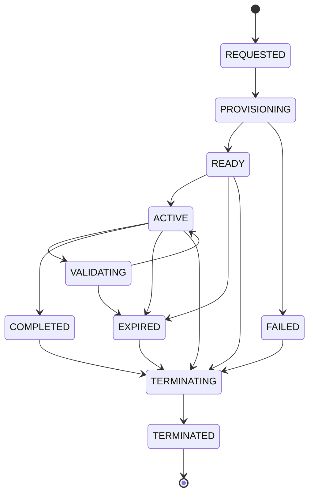

# 08. Especificação do Motor de Laboratórios

| Campo | Valor |
|---|---|
| Versão | 0.2.0 |
| Estado | Proposta implementável, sujeita a PoCs e ADRs |
| Rastreabilidade | FR-010–027, FR-030–034, NFR-003–008/013/015 |

## 1. Responsabilidade

Motor **genérico**, sem `if LAB-001` nem código por linguagem. Consome `LaboratoryVersion` imutável e políticas, solicita provisão via `RuntimePort`, gerencia sessões, grants de gateway, workspace e término. Conteúdo e validadores são artefatos referenciados. Suportar novos labs sem deploy da API.

## 2. Agregados e invariantes

- `LaboratoryVersion` (`lab_id`, `semver`, `manifest_digest`, `image_digest`, `suite_digest`, `published_at`) não pode ser editada após publicação.
- `Session` (`id`, `user_id`, `lab_version_id`, `state`, `revision`, `expires_at`, `runtime_ref`, `last_error`, timestamps).
- No MVP, **no máximo uma sessão executável por aluno e lab**, configurável após decisão de produto; sessões concluídas ou terminadas não contam como ativas.
- `RuntimeInstance` ligado a uma sessão, criado com `session_id` como chave idempotente e rotulado para reconciliação.
- `Session` não contém nota. `Attempt`, `EvaluationRun` e `Completion` são entidades acadêmicas independentes do runtime.
- Versão fixada no início e inalterável durante sessão. Reset não apaga tentativas nem conclusão.

## 3. Máquina de estados



**Esclarecimento:** `VALIDATING` é projeção de UI/um subestado transitório; o estado acadêmico real é `EvaluationRun`. O backend não deve depender de um único campo de sessão para representar avaliações, pois avaliação pode ser completada após perda da conexão. **Política proposta:** expiração revoga novas submissões e acesso ao workspace; avaliações já congeladas podem finalizar em até limite máximo do runner, preservando resultado. Pendente de aprovação.

| Origem | Evento | Destino | Efeito |
|---|---|---|---|
| REQUESTED | job capturado | PROVISIONING | adapter cria instância |
| PROVISIONING | readiness OK | READY | grants permitidos |
| READY | primeira conexão autorizada | ACTIVE | métricas de início |
| READY/ACTIVE | TTL vencido | EXPIRED | revogar gateway |
| READY/ACTIVE | conclusão ou encerramento | COMPLETED/TERMINATING | persistir resultado, encerrar |
| PROVISIONING | falha/timeout | FAILED | erro codificado, cleanup |
| qualquer estado não terminal | cancelamento admin | TERMINATING | revogar sessão |
| TERMINATING | recursos ausentes | TERMINATED | fechamento auditado |

Transições inválidas produzem conflito `409`; usar `revision`/optimistic concurrency ou lock transacional. Workload `READY` não implica `ACTIVE` se aluno ainda não conectou.

## 4. APIs de negócio e idempotência

| Operação | Entrada | Saída imediata | Regra |
|---|---|---|---|
| Criar sessão | lab_id, `Idempotency-Key` | `202`, session_id, REQUESTED | mesma chave + corpo = mesma resposta; chave + corpo distinto = `409` |
| Consultar sessão | session_id | status, TTL, capacidades | ownership, nunca revelar URL bruta sem autorização |
| Resetar | session_id, key | `202`, operation_id | serializar contra snapshot/avaliação |
| Encerrar | session_id, key | `202`, operation_id | idempotente; revoga acesso antes do cleanup |
| Obter grant | session_id, capability | grant curto | vincular usuário/sessão/origem, revogar no fim |

TTL sugerido para PoC: 45 min, sem extensão automática por navegador aberto; pode existir aviso prévio. Definir timeout final com PO. Limites configuráveis por laboratório e quotas globais por pool.

## 5. Scheduler e algoritmo de provisionamento

1. API valida assignment, publicação, quota do usuário e capacidade global.
2. Em **uma transação**: cria Session REQUESTED, grava idempotency key, outbox event.
3. Dispatcher encaminha job ao worker. Worker adquire lease e compara `desired_state`/revision.
4. Worker chama `RuntimePort.provision(session_id, digest, policy)`; nomes de recursos determinísticos por session_id.
5. Se workload já existe e coincide com a versão/política, reusar; se divergir, sinalizar conflito e não reaproveitar.
6. Checar startup, readiness do app/editor/terminal; atualizar READY. Gateway só cria grant para READY/ACTIVE.
7. Reconciliador verifica jobs interrompidos, sessão sem runtime, runtime sem sessão e `expires_at`; realiza ações idempotentes e salva status.

## 6. Reset, falha, expiração e recuperação

- **Reset:** travar revisões de workspace, invalidar grants transitórios, aplicar reset para versão de origem, emitir nova `workspace_revision`. Preservar notas/tentativas. Máximo preliminar: 3 resets por sessão, configurável.
- **Retry de provisionamento:** tentativas limitadas, backoff+jitter; não criar duplicatas; ao exceder, FAILED com código operacional não sensível.
- **Browser fechado:** runtime permanece até TTL; reconectar não provisiona outro ambiente.
- **Expiração:** imediatamente negar gateway/terminal/novas avaliações; reconciliador elimina workload e volumes temporários. Definir e medir SLA de cleanup na PoC.
- **Worker caiu:** lease expira, outro worker compara estado desejado e realidade, sem executar ação duplicada.
- **Cluster indisponível:** estado degradado, nenhuma aprovação presumida, cleanup conciliado posteriormente.

## 7. Interfaces de portabilidade

```python
from typing import Protocol


class RuntimePort(Protocol):
    async def provision(self, session_id: str, manifest_digest: str, policy: dict) -> str: ...
    async def inspect(self, runtime_ref: str) -> dict: ...
    async def reset(self, runtime_ref: str, revision: int) -> None: ...
    async def terminate(self, runtime_ref: str) -> None: ...
```

Implementar `FakeRuntimeAdapter` para testes e `KubernetesRuntimeAdapter` para PoC. Não codificar decisões de risco no front-end.

## 8. Observabilidade e auditabilidade

Eventos `session.requested`, `.provisioning`, `.ready`, `.active`, `.expired`, `.termination_requested`, `.terminated`, `.failed`, `session.reset`. Todas as mensagens carregam `correlation_id`, `session_id`, `lab_version_id`; não usar e-mail em labels de métricas. KPIs: REQUESTED→READY P95, taxa de falha, runtime órfão, cleanup age, custo estimado por sessão.

## 9. Testes de contrato e aceite

- ENG-01: 20 requisições concorrentes com mesma chave criam uma sessão e runtime.
- ENG-02: kill do worker após criar workload não duplica nem deixa órfão.
- ENG-03: session_id de aluno A não permite acesso por B em nenhuma interface.
- ENG-04: reconectar após fechar browser preserva sessão e arquivos até TTL.
- ENG-05: reset restaura código e preserva histórico de tentativas.
- ENG-06: expiração revoga acesso antes da destruição e reconciliador finaliza.
- ENG-07: publicar versão nova não altera sessão existente.
- ENG-08: mock adapter e adapter real satisfazem mesmo contrato.

**Perguntas a aprovar:** sessão simultânea por aluno/lab, TTL e reset, regra de avaliação em expiração, SLA cleanup. Registre decisões no `20_RISKS_AND_DECISIONS.md`.
