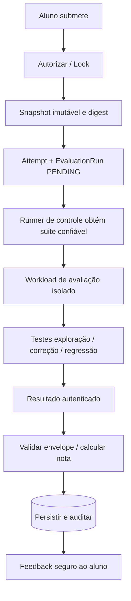

# 10. Motor de Validação Automática

| Campo | Valor |
|---|---|
| Versão | 0.2.0 |
| Estado | Proposta técnica, sujeita a PoC |
| Referências | FR-040–048; BR-006/007/010; NFR-009/010; ADR-003 |

## 1. Objetivo e limites de confiança

Avaliar se o aluno demonstrou exploração **no ambiente de exercício** e corrigiu vulnerabilidade sem regressões. Código, endpoints, stdout, relatórios, logs e arquivos do aluno são **não confiáveis**. Suítes de testes ocultas, rubric e lógica de nota não são montadas no sandbox do aluno. Os testes têm de ser predominantemente comportamentais e reprodutíveis, sem depender apenas de texto do código.

## 2. Vocabulário

`Attempt`: submissão única, registrada com `session_id`, `lab_version_id`, `workspace_revision`, `snapshot_digest`, idempotency_key. `EvaluationRun`: job para um attempt com `suite_digest`, status, timestamps, resultado autenticado e erro operacional. `CriterionResult`: score/resultados por critério. `Completion`: consolidação acadêmica por aluno/versão, independente da existência do runtime.

## 3. Pipeline de avaliação



**Segregação essencial:** controlador de avaliação armazena chaves de serviço, carrega suite por digest e registra a nota; execução da aplicação e testes que processam código do aluno ocorre em sandbox distinto com mínimos privilégios. Não conectar diretamente a banco de notas a partir da workload de avaliação. Resultado autenticado deve ser transmitido por canal protegido e vinculado a evaluation_id/attempt_id.

## 4. Políticas contra fraude e efeitos de corrida

- **Snapshot consistente:** bloquear novas edições durante captura breve ou usar cópia atômica versionada. Avaliação lê snapshot imutável; aluno pode continuar editando depois, sem afetar attempt já submetida.
- **Idempotência:** `Idempotency-Key` repetida + mesmo conteúdo retorna mesmo attempt/run; mesma chave com corpo divergente = `409`. Unique key `(session_id, idempotency_key)`.
- **Serialização:** no MVP, no máximo uma avaliação RUNNING por sessão; submissões adicionais retornam `409` ou fila conforme decisão registrada (proposta: `409` com retry-after).
- **Timeouts:** limites por runner, etapa, processo e output; saída máxima e remoção automática do workload. Timeout = falha técnica explícita, jamais aprovação.
- **Proveniência:** registrar `manifest_digest`, `suite_digest`, `image_digest`, `snapshot_digest`, versão da política de nota, emissor do resultado.
- **Fraude:** ignorar notas e arquivos `result.json` do aluno; evitar shell scripts de validação fornecidos pelo workspace; validar payload de callback contra schema e identidade de serviço.

## 5. Contrato de suite (exemplo proposto)

```yaml
apiVersion: labs.cecyber.io/v1alpha1
kind: ValidationSuite
metadata:
  id: sqli-assessment-v1
  version: 1.0.0
runtime:
  validatorImageDigest: "sha256:<real-digest>"
  timeoutSeconds: 30
criteria:
  - id: exploit-proof
    type: behavioral
    weight: 30
    disclosure: summary
  - id: remediation
    type: behavioral
    weight: 50
    disclosure: summary
  - id: regression
    type: functional
    weight: 20
    disclosure: details
passing:
  minScore: 70
  requiredCriteria: [remediation, regression]
```

Somatória dos pesos deve ser 100, criteria IDs exclusivos e `requiredCriteria` obrigatórios para aprovação independentemente da nota. O autor aprova rubric com o `LabVersion` publicado. Tokens, fixtures protegidas e resultados esperados ficam fora da imagem de workspace.

## 6. Tipos de validação

| Categoria | Princípio | Exemplo do MVP |
|---|---|---|
| `behavioral/exploit` | Evidenciar vulnerabilidade em dataset sintético | LAB-001 observa leitura proibida local, sem rede externa |
| `behavioral/remediation` | Confirmar que ataque previamente eficaz falha após correção | LAB-002 bloqueia leitura cruzada entre contas sintéticas |
| `functional/regression` | Preservar casos legítimos e não regredir | LAB-003 aceita token válido e recusa falsificado |
| `system/containment` | Testar comportamento local restrito | LAB-004 nega execução não esperada, funcionalidade válida permanece |

A avaliação de exploração pode depender de evidência de fase anterior, registrada pelo servidor, ou de snapshot controlado. **A decisão de exigir exploração antes da correção é pedagógica e deve constar no manifesto**. Não confiar em provas de exploração forjadas pelo aluno.

## 7. Estados e resultados

`PENDING → PREPARING → RUNNING → SUCCEEDED | FAILED_TESTS | TIMED_OUT | INFRA_ERROR | CANCELLED`. `SUCCEEDED` significa runner concluiu testes, **não necessariamente** nota de aprovação. `FAILED_TESTS` é execução válida com critérios não satisfeitos; `INFRA_ERROR` deve permitir retry técnico sem gastar tentativa pedagógica (proposta sujeita a aceite).

Exemplo de payload interno **não público**:

```json
{
  "evaluation_id": "uuid",
  "attempt_id": "uuid",
  "snapshot_digest": "sha256:<digest>",
  "suite_digest": "sha256:<digest>",
  "status": "SUCCEEDED",
  "criteria": [{"id":"remediation","passed":true,"score":50}],
  "issued_at": "2026-11-11T23:00:00Z"
}
```

O controlador verifica identidade de emissor, vínculo com job e digest, unicidade e validade do envelope antes de persistir. A nota é calculada pelo backend a partir de critérios e pesos server-side, e não copiada de um campo arbitrário do runner.

## 8. Scoring e feedback

- Pontuação 0–100, pesos da suite versionada, aprovação por `score >= passing.minScore` **e** critérios mandatórios aprovados.
- Status acadêmico `NOT_STARTED`, `IN_PROGRESS`, `PASSED`, `COMPLETED` conforme regra de produto. Proposta padrão: melhor tentativa válida; não apagar tentativas anteriores.
- Feedback: nome do critério, status, pontos, explicação curta e orientação educativa. Não revelar casos ocultos, fixture secretas, dados de outros alunos ou detalhes de runtime.
- Resposta `202` ao submeter; `GET /api/v1/attempts/{id}` retorna status/feedback filtrado e autorizado.

## 9. Casos de falha e recuperação

| Cenário | Política proposta |
|---|---|
| sessão expira após snapshot | avaliação já enfileirada termina dentro do timeout, sem acesso ao sandbox expirado |
| usuário ressubmete chave | retorna mesmo attempt |
| runner morre após escrever resultado | retorno idempotente, resultado único |
| falha de infraestrutura | status INFRA_ERROR, retry técnico limitado, sem nota falsa |
| reset durante captura | operações serializadas; reset aguarda/falha com conflito |
| envio de resultado forjado | rejeitar e auditar incidente |
| suite foi retirada por risco | bloquear jobs novos, manter histórico e aplicar política de revogação explícita |

## 10. Plano de testes e critérios de aceite

- VAL-01: solução correta em LAB-001 a 004 passa em execuções repetidas; soluções incorretas falham.
- VAL-02: corrigir vulnerabilidade quebrando funcionalidade legítima não aprova.
- VAL-03: alteração posterior ao snapshot não altera nota.
- VAL-04: aluno não lê suite oculta nem força resultado por arquivos locais.
- VAL-05: callbacks forjados, replay e IDs trocados são rejeitados.
- VAL-06: duas submissões idempotentes não duplicam nota ou tentativas.
- VAL-07: timeout e falha técnica não provocam aprovação.
- VAL-08: dashboard apresenta melhor resultado válido e histórico íntegro após destruição do lab.

**Pendências para PO e Segurança:** definição de tentativas máximas, exigência de exploração antes de correção, política de infra error/expiração e granularidade de feedback. Formalizar ADR-003 após PoC.

## Adendo v0.3: validação pedagógica por etapa

Todas as etapas que condicionam progressão têm validatorRef protegido. Ao passar, atualizar StepAttempt/EvaluationRun e desbloquear próxima etapa em transação; falha de infraestrutura do validador não reprova nem desbloqueia. Uso de dica gera HintUsage auditável, com eventual penalidade somente se configurada. Ver 11, 12, 13 e 21.
