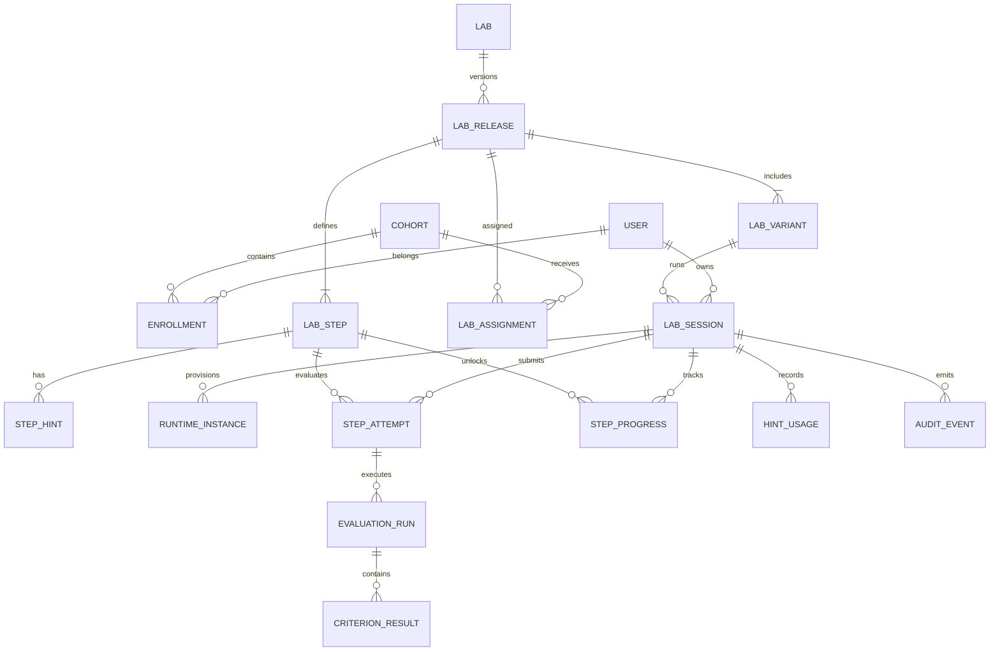

# 12. Modelo de Dados Lógico

| Campo | Valor |
|---|---|
| Produto | CECyber AppSec Labs |
| Versão | 0.3.0 |
| Estado | Proposta para revisão, migrações ainda não implementadas |
| Banco sugerido | PostgreSQL on-premises |

## 1. Domínios e relações

## 2. Tabelas essenciais e campos mínimos

| Tabela | Chave e atributos principais | Restrições |
|---|---|---|
| `users` | `id uuid`, `idp_subject`, `display_name`, `email`, `role`, `created_at` | `idp_subject` único; email não é identidade de autorização |
| `cohorts` | `id`, `name`, `status` | exclusão lógica quando houver resultados |
| `enrollments` | `id`, `cohort_id`, `user_id`, `status` | único (`cohort_id`,`user_id`) |
| `labs` | `id text`, `title`, `primary_cwe` | id estável |
| `lab_releases` | `id`, `lab_id`, `version`, `manifest_digest`, `status`, `published_at` | único (`lab_id`,`version`); publicada é imutável |
| `lab_variants` | `id`, `release_id`, `variant_key`, `language`, `framework`, `image_digest`, `runtime_profile` | único (`release_id`,`variant_key`) |
| `lab_steps` | `id`, `release_id`, `step_key`, `position`, `validator_ref`, `max_points` | únicos (`release_id`,`step_key`) e (`release_id`,`position`) |
| `step_hints` | `id`, `step_id`, `level`, `content_ref` | único (`step_id`,`level`) |
| `lab_assignments` | `id`, `cohort_id`, `release_id`, `start_at`, `end_at` | autorização por turma |
| `lab_sessions` | `id`, `user_id`, `variant_id`, `release_id`, `status`, `expires_at`, `created_at`, `version_num` | FKs fixas para release/variant, version para locking |
| `runtime_instances` | `id`, `session_id`, `provider`, `external_ref`, `status`, `created_at`, `terminated_at` | `external_ref` único se preenchido |
| `step_progress` | `id`, `session_id`, `step_id`, `status`, `unlocked_at`, `passed_at`, `best_score` | único (`session_id`,`step_id`) |
| `step_attempts` | `id`, `session_id`, `step_id`, `revision_hash`, `idempotency_key`, `created_at` | único (`session_id`,`idempotency_key`) |
| `evaluation_runs` | `id`, `attempt_id`, `validator_version`, `status`, `started_at`, `ended_at`, `score` | status controlado, resultado imutável ao concluir |
| `criterion_results` | `id`, `run_id`, `criterion_key`, `passed`, `score`, `feedback_code`, `evidence_ref` | único (`run_id`,`criterion_key`) |
| `hint_usage` | `id`, `session_id`, `step_id`, `hint_id`, `created_at` | registrar uso, não sobrescrever |
| `lab_completions` | `id`, `user_id`, `release_id`, `session_id`, `score`, `completed_at` | associação à versão e política de conclusão |
| `audit_events` | `id`, `actor_id`, `action`, `resource_kind`, `resource_id`, `occurred_at`, `trace_id`, `metadata` | append-only lógico |

## 3. Invariantes transacionais

- Um `step_progress` só muda `LOCKED -> AVAILABLE -> IN_PROGRESS -> PASSED` por transação autorizada; repetir avaliação aprovada não reverte progresso.
- Ao publicar release, congelar manifesto, estrutura de etapas, dicas e variantes; novas versões não modificam sessões ativas.
- `UNLOCK` da próxima etapa e commit de avaliação aprovada devem ocorrer numa única transação.
- A criação de sessão é idempotente por usuário/escopo/chave; proteger com constraint e transação.
- Resultados, notas e auditoria não dependem da existência do runtime efêmero.
- Não manter conteúdo secreto dos validadores em tabelas expostas a consultas do aluno.

## 4. Índices mínimos

`lab_sessions(user_id,status)`, `lab_sessions(expires_at,status)`, `step_progress(session_id,status)`, `step_attempts(session_id,step_id,created_at DESC)`, `evaluation_runs(attempt_id)`, `lab_assignments(cohort_id,release_id)`, `audit_events(occurred_at)`; revisar com `EXPLAIN ANALYZE` após testes.

## 5. Segurança, retenção e privacidade

RBAC e ownership na API, política de menor privilégio no PostgreSQL, backup criptografado e teste de restauração; retenção de logs, artefatos temporários, evidências e dados pessoais sujeita a definição LGPD. Nunca armazenar tokens em claro nos eventos. Separar volume efêmero do workspace da persistência acadêmica. Não usar PII real nos exemplos de laboratório.

## 6. Migrações e testes

Migrações reversíveis quando possível, forward-only para mudanças de dados imutáveis. Testar FK, concorrência de liberação de etapa, reexecução idempotente, delete lógico e consultas que tentem cruzar `user_id`/turma. A implementação SQL exata e as políticas de retenção ficam pendentes de decisão.
