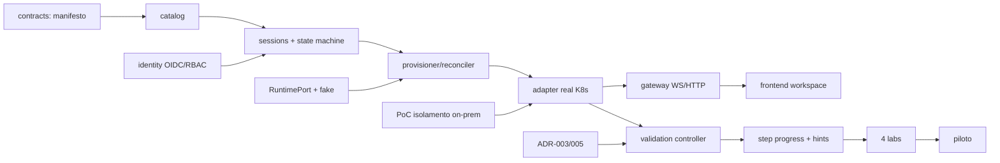

# 23. Plano de Implementação

| Campo | Valor |
|---|---|
| Produto | CECyber AppSec Labs |
| Versão | 0.1.0 |
| Estado | Proposta para revisão do PO; sem prazos comprometidos |
| Data | 2026-11-11 |
| Base | `22_PROJECT_INITIAL_ASSESSMENT.md`, `02_PRD.md`, `08`–`14`, `21`, ADR-001–007 |

> Não há datas: equipe, disponibilidade e infraestrutura não são conhecidas. A ordem e as dependências são o compromisso; a duração será estimada depois das PoCs (`15 §Próximas atividades`).

## 1. Princípios de execução

1. **Fatias verticais pequenas**, cada uma com testes, documentação e atualização de `25_DEVELOPMENT_STATUS.md`.
2. **Plano de controle primeiro, com fake adapter**; nada vulnerável roda antes do gate de isolamento (G5).
3. **Contrato antes de implementação**: manifesto, port de runtime, API e envelope do runner são versionados e testados por contrato.
4. **Monólito modular** (FastAPI) + workers no mesmo código-base; serviços separados apenas onde há fronteira de confiança (runner de validação, gateway de workspace).
5. **Sem tecnologia nova com dependência operacional** sem ADR aprovado (ex.: Redis, broker, service mesh).

## 2. Arquitetura-alvo resumida

```text
Navegador ── HTTPS ──> API FastAPI (monólito modular) ──> PostgreSQL (dados + outbox + fila)
     │                        │
     │                        └─ workers (provisioner, reconciler, evaluator-dispatcher)
     │                                   │ RuntimePort
     └─ WS/HTTP ─> Workspace Gateway ──> Sandbox por sessão (zona sandbox, egress deny)
                                         ▲
                     Validation Controller ── workload de avaliação isolado
```

| Componente | Local no repositório | Fronteira de confiança |
|---|---|---|
| API + módulos de domínio | `apps/backend/app/` | Controle (confiável) |
| Workers (provisioner, reconciler) | `apps/backend/app/workers/` | Controle |
| Contratos (manifesto, JSON Schema) | `packages/contracts/` | Compartilhado, sem lógica de runtime |
| Adapter de runtime | `apps/backend/app/runtime/` | Controle → orquestrador (credencial limitada) |
| Validation controller | `services/validator/` (fase 4) | Controle, processo separado |
| Workspace gateway | `services/gateway/` (fase 3) | Borda; só roteia `session_id → runtime_ref` |
| Frontend | `apps/frontend/` (fase 3) | Não confiável |
| Conteúdo de labs | `laboratories/<lab>/` (manifesto, conteúdo, runtime) | Público ao aluno |
| Validadores privados | repositório/artefato **separado** (não neste repo) | Protegido |

## 3. Fases e marcos

| Fase | Marco | Objetivo | Entra | Gate de saída |
|---|---|---|---|---|
| F0 | M0 Diagnóstico | Docs 22–25, ADRs 005–007 propostos | Pacote v0.3 | PO revisa e aprova/ajusta ADRs |
| F1 | M1 Motor mínimo (1ª fatia) | Manifesto → registro → sessão → fake runtime → estado → encerramento | M0 | Testes ENG-01/02/06/07/08 parciais verdes; CI local |
| F2 | M2 Plano de controle completo | OIDC, RBAC/ownership, turmas/atribuições, quotas, reset, TTL, auditoria, OpenAPI, métricas OTel | M1 + OPEN-01 | SEC-01, E2E-02/03/07 com fake adapter |
| F2-infra (paralela) | M2i PoC on-prem | Inventário, K8s on-prem, gVisor vs Kata, rede segregada, registry | ADR-004 + inventário | ADR-001/002 aprovados; SEC-04–06/11/14 |
| F3 | M3 Workspace | Adapter real, gateway HTTP/WS com tickets, editor (Monaco), terminal (xterm.js), preview, build/run | M2 + M2i | E2E-01 com lab benigno; SEC-03/13 |
| F4 | M4 Validação por etapa | Snapshot, runner protegido, envelope autenticado, step progress transacional, hints | M3 + ADR-003/005 + OPEN-04 | VAL-01–08 com lab benigno |
| F5 | M5 Conteúdo | LAB-001, LAB-002, LAB-003; LAB-004 só após contenção | M4 + `17` especificado | G4 (≥3 etapas validadas por lab) |
| F6 | M6 Prontidão de piloto | Dashboard instrutor/admin, CSV, runbook, carga 30 sessões, testes adversariais | M5 | G5 e G6 |

### Dependências entre componentes



## 4. Primeira fatia funcional ponta a ponta (vertical slice — F1)

**Objetivo:** criar uma definição de laboratório benigna, registrá-la, iniciar uma sessão pelo adaptador de runtime, consultar seu estado e encerrar a sessão — sem vulnerabilidades e sem código não confiável.

| # | Capacidade | Entrega | Requisitos |
|---|---|---|---|
| 1 | Contrato de manifesto | Modelos Pydantic `AppSecLab v1alpha1` + JSON Schema exportado | FR-011, `11` |
| 2 | Validação do manifesto | Estrutural (schema) + semântica (regras 1–5, 7, 8 de `11 §3`, tetos de perfil) | FR-011, US-004 |
| 3 | Registro de laboratório | `POST /api/v1/admin/lab-releases` idempotente por digest; `GET /api/v1/labs` | FR-010/012 |
| 4 | Criação de sessão | `POST /api/v1/sessions` com `Idempotency-Key`, `202`, fingerprint de corpo | FR-020/022 |
| 5 | Máquina de estados | Transições explícitas, `409` em inválidas, optimistic locking (`version_num`) | FR-021, `08 §3` |
| 6 | Adaptador de runtime | `RuntimePort` consolidado + `FakeRuntimeAdapter` com injeção de falha | NFR-015, ENG-08 |
| 7 | Persistência | PostgreSQL + SQLAlchemy 2 + Alembic; outbox e fila de jobs no banco | `12`, ADR-007 |
| 8 | Encerramento e limpeza | `DELETE /api/v1/sessions/{id}` → `TERMINATING` → worker → `TERMINATED`; reconciliador de TTL e órfãos | FR-025/026 |
| 9 | Testes automatizados | Unitários, integração (PostgreSQL real), concorrência e falha | ENG-01/02/06/07/08 |
| 10 | Logs estruturados | JSON com `correlation_id`, `session_id`, evento; auditoria em tabela | FR-053, NFR-010/013 |

**Limitações explícitas da F1:** autenticação em modo de desenvolvimento (cabeçalho), sem OIDC; sem sandbox real; sem gateway, editor, terminal ou validação; sem métricas OTel exportadas (apenas logs). Nada disso é declarado como pronto.

## 5. Critérios de aceite por marco

| Marco | Critérios de aceite verificáveis |
|---|---|
| M1 | (a) manifesto inválido é rejeitado com erros localizados; (b) release publicada não pode ser sobrescrita com conteúdo diferente; (c) 20 POSTs concorrentes com a mesma chave criam 1 sessão e 1 runtime; (d) chave igual + corpo diferente = `409`; (e) usuário B recebe `404` na sessão de A; (f) sessão chega a `READY` via worker e a `TERMINATED` após `DELETE`, sem runtime remanescente no adapter; (g) falha de provisionamento leva a `FAILED` e limpeza; (h) TTL vencido leva a `EXPIRED`→`TERMINATED`; (i) runtime órfão é removido pelo reconciliador; (j) lab benigno registrado sem alteração de código do motor. |
| M2 | Login OIDC real em staging; RBAC + escopo de turma; quotas por usuário/turma/global; reset limitado; OpenAPI publicada e testada por contrato; métricas `session_provision_duration_seconds` exportadas via OTel. |
| M2i | ADR-001/002 aprovados com evidências; SEC-04/05/06/11/14 executados em ambiente descartável on-prem. |
| M3 | E2E-01 com lab benigno; tickets de gateway expiram, são revogados no término e não funcionam para outra sessão (SEC-01/03/13). |
| M4 | VAL-01–08 com lab benigno; desbloqueio atômico; `ERROR` não desbloqueia nem penaliza. |
| M5 | G4 para LAB-001–003; LAB-004 só com parecer de contenção. |
| M6 | G5 e G6, runbook revisado, carga de 30 sessões medida. |

## 6. Testes necessários

| Nível | Ferramenta | Cobertura mínima |
|---|---|---|
| Unitário | pytest | State machine (todas as transições válidas e inválidas), validação de manifesto (positivos e negativos), fingerprint de idempotência |
| Contrato | pytest | `RuntimePort`: mesma suíte executada contra fake e adapter real (ENG-08); JSON Schema exportado == modelo |
| Integração | pytest + PostgreSQL real | API + banco + worker; concorrência (ENG-01), falha de worker (ENG-02), expiração (ENG-06), imutabilidade (ENG-07) |
| Segurança | pytest + PoC | SEC-01–14 conforme fase; ownership desde F1 |
| E2E | Playwright (F3+) | E2E-01–10 |
| Carga | k6 ou Locust (F6, ADR antes) | 30 sessões, P95 READY |
| Adversarial | manual + automatizado | Escape, rede lateral, fraude de validador (G5) |

Regra: **componentes de provisionamento, execução e validação exigem testes negativos e de falha** antes de serem considerados prontos.

## 7. Estratégia de desenvolvimento local

- PostgreSQL 16 via `infrastructure/local/docker-compose.yml` (componente **confiável**) ou instância local; `scripts/dev-db.sh` para um cluster descartável sem Docker.
- Backend executado com `uvicorn`; worker com `python -m app.workers.run`.
- `RUNTIME_ADAPTER=fake` é o único adapter disponível na F1. **Nenhum** adapter local executa imagens de laboratório no host do desenvolvedor.
- `APP_ENV=local|test` habilita autenticação de desenvolvimento por cabeçalho `X-Dev-User`; em qualquer outro `APP_ENV` a aplicação **recusa iniciar** com esse modo.
- Segredos somente por variáveis de ambiente (`.env` fora do Git; `.env.example` sem valores reais).

## 8. Estratégia de deploy on-premises

| Zona | Componentes | Controles |
|---|---|---|
| Administrativa | API, workers, PostgreSQL, registry, observabilidade, validation controller | Rede de gestão separada, mTLS interno, backup testado |
| Sandbox | Nós dedicados para sessões; RuntimeClass endurecida | Egress deny, sem rota para gestão/backup/corporativo, sem service account, PSA restricted |
| Borda | Gateway de workspace + proxy reverso TLS | Tickets curtos, Origin check, subdomínio segregado para preview |

Sequência: (1) inventário e desenho de VLAN/firewall; (2) cluster de PoC descartável; (3) staging com dados sintéticos; (4) piloto com usuários convidados após G5. Entrega via imagens OCI por digest; manifests de deploy em `infrastructure/on-prem/` (Helm/Kustomize, decisão em ADR futuro). Nenhuma implantação em produção sem autorização explícita do PO.

## 9. Ordem de implementação (resumo executável)

1. F1 — fatia do motor (este incremento): contratos → catálogo → sessões → fake runtime → workers → testes.
2. F1 — CI (lint, type-check, testes com PostgreSQL de serviço).
3. F2 — OpenAPI + testes de contrato; identity (OIDC) após OPEN-01; turmas/atribuições; quotas; reset; métricas OTel.
4. F2-infra em paralelo — inventário e PoC de isolamento.
5. F3 — adapter K8s; gateway; frontend do workspace.
6. F4 — ADR-003/005 aprovados → snapshot → runner → progresso por etapa → hints.
7. F5 — conteúdo dos labs (LAB-001 primeiro).
8. F6 — relatórios, operação, carga, adversarial, piloto.

## 10. Riscos e mitigação

| Risco (ver `22 §7`) | Mitigação no plano |
|---|---|
| R-01 isolamento | F2-infra paralela; F3 depende de M2i; LAB-004 condicionado |
| R-02 infra desconhecida | Plano de controle avança com fake adapter; inventário é pré-requisito explícito |
| R-03 validação forjável | F4 só após ADR-003; envelope autenticado; testes VAL antes de conteúdo |
| R-04 acoplamento | Teste de lab benigno + variante simulada desde F1 |
| R-05 modelo acadêmico | ADR-005 proposto em F0, decidido antes de F4 |
| R-06 órfãos | Reconciliador e `list_owned` já na F1 |
| R-10 escopo | Gates por fase; backlog com histórias pequenas (`24`) |
